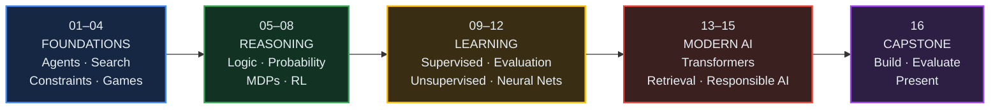
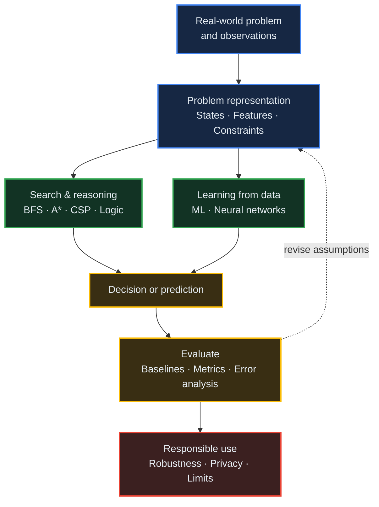
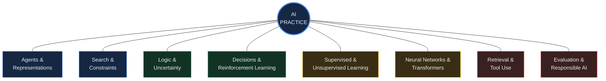
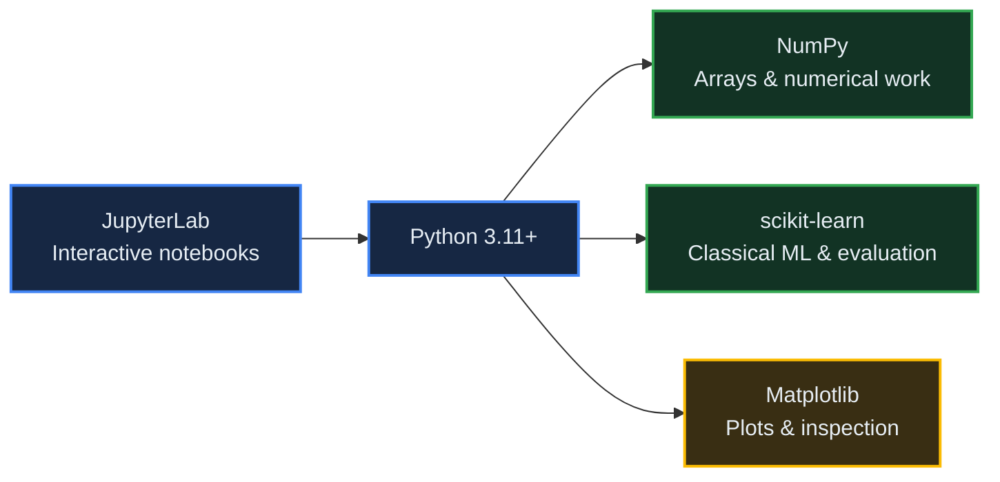

<p align="center">
  
  
  
  
  
  
</p>

<h1 align="center">Artificial Intelligence</h1>
<h3 align="center">From Intelligent Agents to Modern Generative Systems</h3>

<p align="center">
  <strong>SARIAU (SRB University) — Fall 2026 Semester</strong><br/>
  <em>A 16-session, hands-on university course designed and taught by Mohammad Asadolahi.</em>
</p>

<p align="center">
  <a href="#-course-overview">Overview</a> •
  <a href="#-learning-journey">Journey</a> •
  <a href="#-session-breakdown">Sessions</a> •
  <a href="#-architecture">Architecture</a> •
  <a href="#-skills-acquired">Skills</a> •
  <a href="#-getting-started">Setup</a> •
  <a href="#-technology-ecosystem">Tech Stack</a>
</p>

---

## 📌 Course Overview

Artificial intelligence is more than a single model or chatbot. This course takes students from **search and intelligent agents** through **reasoning under uncertainty**, **machine learning**, and **modern generative systems**. The goal is to understand not only how AI methods work, but also how to test them, interpret their results, and recognize their limitations.

Each session pairs a clear explanation of the underlying ideas with small, practical Python exercises. The course is designed for students who already know basic programming, algebra, and probability; advanced hardware and paid AI APIs are not required for the core activities.

> **Philosophy:** *Understand the idea. Trace a small example. Build it in Python. Measure what happens. Explain where it fails.*

### A Note About Weekly Releases

**This is the student-facing course repository. Materials will be published one session at a time, following the class schedule.** The complete set of notebooks will **not** be uploaded in advance.

**Session 01 is now available in English and Persian.** Later notebooks will appear here only when their sessions are released. The session outline below shows links only for published materials.

### What Makes This Course Different

| | Typical Topic-by-Topic Survey | This Course |
|---|---|---|
| **Approach** | Definitions and algorithms in isolation | Ideas, worked examples, code, and evaluation |
| **Scope** | Often weighted toward one AI subfield | Classical AI, machine learning, and modern systems |
| **Practice** | Exercises separate from the theory | A small working notebook for each released session |
| **Tools** | Sometimes require cloud services | Core labs run locally on a CPU |
| **Evidence** | A correct output alone | Baselines, metrics, error analysis, and limitations |
| **Final project** | A demonstration | A reproducible AI system with an evaluation |

---

## 🗺️ Learning Journey

We start with how an agent represents a problem and chooses an action, then move toward learning from data and building systems that can be evaluated responsibly.



### Five Phases of the Course

| Phase | Sessions | Central question |
|---|:---:|---|
| **Foundation** | 01–04 | How does an intelligent agent find or choose a solution? |
| **Reasoning & Decisions** | 05–08 | How can a system reason and act with incomplete information? |
| **Learning from Data** | 09–12 | How do models learn patterns, and how do we judge them? |
| **Modern & Responsible AI** | 13–15 | How do contemporary AI systems use language, retrieval, and tools safely? |
| **Capstone** | 16 | Can we build something reproducible and defend its evaluation? |

---

## 📚 Session Breakdown

> **Release policy:** The topics are listed for planning. Notebook links will be added **only when that week's session is published**.

### Session 01 — Introduction to AI and Intelligent Agents

**Available notebooks:** [English](session_01_ai_agents.ipynb) · [فارسی (Persian)](persian_notebooks/session_01_ai_agents.ipynb)

> What makes a system an intelligent agent, and how can we measure its behavior?

- AI, machine learning, deep learning, and generative AI
- Agents, environments, observations, actions, and performance measures
- Simple rule-based behavior and baseline comparisons

### Session 02 — Uninformed and Informed Search

> Turn a problem into a state space and find a route to the goal.

- Breadth-first, depth-first, and uniform-cost search
- Heuristics and A* search
- Comparing explored states, path quality, and computational cost

### Session 03 — Constraint Satisfaction Problems

> Solve problems by combining choices with rules.

- Variables, domains, and constraints
- Backtracking and search ordering
- Constraint propagation and why it helps

### Session 04 — Adversarial Search and Game Playing

> Choose actions when another player is trying to stop you.

- Game trees, utility, and minimax
- Alpha-beta pruning
- Evaluating decisions with limited search depth

### Session 05 — Knowledge Representation and Logical Inference

> Represent knowledge explicitly and derive new conclusions.

- Propositions, logical rules, and entailment
- Knowledge bases and inference
- Assumptions, consistency, and explainable conclusions

### Session 06 — Probability and Bayesian Reasoning

> Reason carefully when the evidence is uncertain.

- Conditional probability and Bayes' rule
- Updating beliefs with evidence
- Interpreting probabilistic predictions

### Session 07 — Decision-Making with Markov Decision Processes

> Plan actions when outcomes and rewards can be uncertain.

- States, actions, transitions, and rewards
- Policies and expected return
- Bellman updates and value iteration

### Session 08 — Reinforcement Learning and Q-Learning

> Learn useful behavior through interaction and feedback.

- Exploration versus exploitation
- Q-values and temporal-difference updates
- Comparing learned policies with simple baselines

### Session 09 — Supervised Learning: Regression and Classification

> Learn mappings from examples without confusing memorization with generalization.

- Features, targets, and training
- Regression and classification
- Baselines and interpretable predictions

### Session 10 — Model Evaluation, Validation and Data Leakage

> A model is only as convincing as the way it is tested.

- Train, validation, and test splits
- Classification and regression metrics
- Cross-validation, data leakage, and honest comparisons

### Session 11 — Unsupervised Learning and Dimensionality Reduction

> Find useful structure when labels are unavailable.

- Clustering and similarity
- Dimensionality reduction
- Visualizing patterns and questioning apparent groups

### Session 12 — Neural Networks and Deep Learning

> Understand the building blocks behind modern learned representations.

- Neurons, layers, and activation functions
- Loss functions and gradient-based learning
- Training behavior, overfitting, and limitations

### Session 13 — NLP, Attention and Transformers

> Explore how language systems represent context.

- Text representation and tokenization
- Attention and the transformer idea
- Capabilities and failure modes of language models

### Session 14 — Retrieval-Augmented Systems and Tool-Using Agents

> Connect a system to relevant information and bounded tools.

- Retrieving and ranking useful context
- Tool selection and execution boundaries
- Grounding answers and checking sources

### Session 15 — Responsible AI, Robustness and Evaluation

> Test how an AI system behaves beyond the examples that made it look good.

- Fairness, privacy, and documentation
- Robustness and distribution shift
- Failure analysis, safe use, and human oversight

### Session 16 — Capstone: Build, Evaluate and Present an AI System

> Bring representation, implementation, evaluation, and responsibility into one project.

- Define a problem and a defensible baseline
- Build a reproducible working system
- Report results, errors, limitations, and responsible-use considerations

---

## 🏗️ Architecture

Across the semester, different techniques solve different parts of an AI problem. The diagram below shows the **conceptual architecture** that connects them — not a claim that every project must include every component.



The unifying idea is simple: **represent a problem → choose a method → build a baseline → evaluate → improve**.

---

## 🎯 Skills Acquired

By the end of the course, students should be able to explain, implement, and evaluate representative methods across eight connected areas.



---

## 📊 Concept Coverage Matrix

Some ideas are central to one phase and revisited in later phases. The matrix is a curriculum map, not a performance score.

| Concept | 01–04 | 05–08 | 09–12 | 13–15 | 16 |
|---|:---:|:---:|:---:|:---:|:---:|
| Agents, search, and constraints | ● | ◐ | — | ◐ | ◐ |
| Logic, uncertainty, and decisions | ◐ | ● | — | ◐ | ◐ |
| Machine learning and neural models | — | ◐ | ● | ◐ | ◐ |
| Language, retrieval, and tool use | — | — | ◐ | ● | ◐ |
| Baselines, testing, and error analysis | ◐ | ◐ | ● | ● | ● |
| Responsible and reproducible AI | ◐ | ◐ | ◐ | ● | ● |

**●** Primary focus &nbsp;&nbsp; **◐** Connected or revisited &nbsp;&nbsp; **—** Not a primary focus

---

## ⚙️ Technology Ecosystem

The core notebooks are designed around a small local Python stack. No GPU, cloud account, or paid model API is needed for the required exercises.



### Core Stack

| Layer | Technology | Purpose |
|---|---|---|
| **Language** | Python 3.11+ | Algorithms, experiments, and exercises |
| **Notebook environment** | JupyterLab | Interactive learning |
| **Numerical computing** | NumPy | Arrays and calculations |
| **Machine learning** | scikit-learn | Models, data preparation, and evaluation |
| **Visualization** | Matplotlib | Inspecting data and results |
| **Course distribution** | GitHub | One published session at a time |

---

## 🚀 Getting Started

### Prerequisites

- Python 3.11 or later
- Familiarity with basic Python functions, loops, and lists
- Introductory algebra and probability
- JupyterLab or VS Code with the Jupyter extension

### Installation

Clone the student-facing repository:

```bash
git clone https://github.com/MohammadAsadolahi/Artificial-Intelligence-Course-Fall-2026.git
cd Artificial-Intelligence-Course-Fall-2026
```

When the first notebook becomes available, prepare a local environment:

```bash
python -m venv .venv
source .venv/bin/activate  # Windows: .venv\Scripts\activate
python -m pip install jupyterlab numpy scikit-learn matplotlib
jupyter lab
```

### Running the Notebooks

1. Open this repository after your week's session has been released.
2. Download the published notebook or pull the latest changes with `git pull`.
3. Open the notebook in JupyterLab or VS Code.
4. Run the cells in order, make a prediction, and change one assumption to see what happens.

> **Now available:** Session 01 in [English](session_01_ai_agents.ipynb) and [Persian](persian_notebooks/session_01_ai_agents.ipynb). Future notebook links will be added as each session is released.

---

## 📂 Repository Structure

The Spring 2026 course used a straightforward, student-friendly layout. This repository follows the same approach: a main README with individual session notebooks released gradually, rather than publishing all future material at once.

**Current public contents:**

```text
.
├── README.md
├── session_01_ai_agents.ipynb
└── persian_notebooks/
    └── session_01_ai_agents.ipynb
```

**Planned additions as the semester progresses (not yet published):**

```text
session_02_graph_search.ipynb
session_03_constraints.ipynb
...
session_16_capstone.ipynb
persian_notebooks/
    session_02_graph_search.ipynb
    ...
```

Only released files will be present. Future filenames above illustrate the format; they are **not** links to hidden course materials.

---

## 🎓 Course Summary & Release Board

| Session | Topic | Notebook |
|:---:|---|:---:|
| **01** | Introduction to AI and Intelligent Agents | [English](session_01_ai_agents.ipynb) · [فارسی](persian_notebooks/session_01_ai_agents.ipynb) |
| **02** | Uninformed and Informed Search | Coming soon |
| **03** | Constraint Satisfaction Problems | Coming soon |
| **04** | Adversarial Search and Game Playing | Coming soon |
| **05** | Knowledge Representation and Logical Inference | Coming soon |
| **06** | Probability and Bayesian Reasoning | Coming soon |
| **07** | Decision-Making with MDPs | Coming soon |
| **08** | Reinforcement Learning and Q-Learning | Coming soon |
| **09** | Supervised Learning: Regression and Classification | Coming soon |
| **10** | Model Evaluation, Validation and Data Leakage | Coming soon |
| **11** | Unsupervised Learning and Dimensionality Reduction | Coming soon |
| **12** | Neural Networks and Deep Learning | Coming soon |
| **13** | NLP, Attention and Transformers | Coming soon |
| **14** | Retrieval-Augmented Systems and Tool-Using Agents | Coming soon |
| **15** | Responsible AI, Robustness and Evaluation | Coming soon |
| **16** | Capstone: Build, Evaluate and Present an AI System | Coming soon |

The board will be updated as each weekly notebook is published.

---

## 🔮 Where to Go Next

This course provides a starting point for deeper work in:

- **Search and Planning** — Efficient algorithms, scheduling, and optimization
- **Probabilistic AI** — Bayesian networks and decision-making under uncertainty
- **Machine Learning** — More advanced modeling and generalization
- **Deep Learning** — Vision, language, and multimodal models
- **Agentic Systems** — Retrieval, tools, planning, and human oversight
- **AI Evaluation** — Reliability, robustness, transparency, and responsible deployment

---

<p align="center">
  <br/>
  <strong>Designed & Taught by Mohammad Asadolahi</strong><br/>
  <em>SARIAU (SRB University) — Fall 2026</em><br/>
</p>
